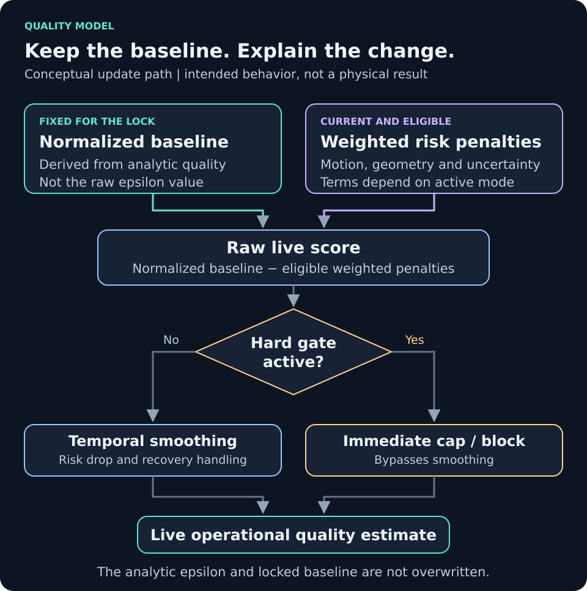

# Grasp quality: analytic baseline and live estimate

Commands and runtime paths use `app/` as the working directory unless stated otherwise.

[Project overview](../README.md) · [Documentation index](index.md)

The project exposes two related quantities. Keeping them separate is central
to interpreting the demo correctly.

| Quantity | What it describes | What can change it |
|---|---|---|
| **Analytic quality** | The estimated geometric quality of the locked grasp, derived from contact/depth inputs and epsilon/wrench-space analysis | An explicit new lock or recomputation with new inputs |
| **Live operational quality** | A current risk estimate relative to that baseline | Eligible current evidence, configured penalties, hard gates, and temporal smoothing |

> This page explains the intended model. Freshness and display-validity
> limitations can allow old inputs to produce current-looking guidance. A score
> alone is not evidence of current physical stability.



*Conceptual update path. [Full size](assets/quality-update.svg).*

## Analytic quality

RealSense supplies the geometry, depth, intrinsics, and estimated contact
inputs. The canonical implementations are
[`epsilon_wrench.py`](../app/src/grasp_project/realsense/epsilon_wrench.py) and
[`quality_matrix.py`](../app/src/grasp_project/realsense/quality_matrix.py).
The top-level [`epsilon_quality.py`](../app/epsilon_quality.py) preserves the older
import/command path.

Analytic epsilon and any normalized dashboard score are different quantities.
Retain the metric definition and normalization when reporting a number. A
planned contact model is not a measured physical contact or force, and a
favorable estimate is not proof that a pickup will succeed.

## DAVIS contribution to live quality

In the hand-operated presentation, the dashboard makes the RealSense baseline
and DAVIS adjustment explicit. Eligible incipient-slip, gross-slip, rotation,
and vibration evidence can contribute penalties to live quality. **DAVIS does
not recompute analytic epsilon or overwrite the locked baseline matrix.**

The existing live-quality implementation lives in
[`live_quality_monitor.py`](../app/src/grasp_project/quality/live_quality_monitor.py).
The broader engineering path includes RGB-D, optional point-cloud, uncertainty,
and synchronization terms. Its documented structure is:

```text
raw live score = analytic score - eligible weighted risk penalties
live score = temporal smoothing of the raw score, subject to immediate hard gates
```

Use [the live-quality methodology](live_quality_methodology.md) and
[`config/live_quality.yaml`](../app/config/live_quality.yaml) for the detailed
terms and gates. The presentation's DAVIS adjustment is one contribution; it
must not be confused with the entire unsmoothed score delta in every mode.

## When evidence is excluded

Raw events can be visible while the DAVIS adjustment is excluded. The current
hand-operated report describes checks for a valid analytic baseline and lock
identity, current object-local evidence, sufficient event support/confidence,
post-grasp declaration, acceptable timing, and disturbance rejection.

Lighting changes, camera shake, background/global activity, stale data, or
invalid provenance do not by themselves establish bottle slip. An exclusion
means that evidence is not eligible to adjust the score. It is not proof of a
stable physical grasp.

The configured middle-third DAVIS view is an acquisition region. The report
describes a separate confirmed APS contour and RealSense lock association for
object-local estimation. That association remains uncalibrated and physically
unvalidated. APS provides context/localization; it does not supply metric depth.

## Reading and reporting a result

Retain the baseline and live score, lock/compute identity, timestamp, inclusion
or exclusion reason, and the sensor evidence used. The exported timeline
includes `davis_adjustment_points`, `davis_adjustment_status`, and
`davis_adjustment_reason` in the documented hand-operated workflow.

Describe these as model-based quality and operational risk estimates. Physical
slip accuracy, force, contact, and grasp success require their own controlled
evidence. Physical contact, force, slip and grasp-success claims require
independent retained measurements.

## Terms at a glance

| Term | Meaning here |
|---|---|
| Analytic epsilon | Wrench-space metric computed from the selected contact model |
| Normalized analytic score | Dashboard-scale representation used as the live-score baseline; not the raw epsilon |
| APS | DAVIS frame-based image channel, used for scene context/localization |
| Event | Pixel brightness-change observation; individual activity is not a slip label |
| Incipient-slip cue | An estimator of developing motion risk, still requiring physical onset validation |
| Temporal synchronization | Software comparison of acquisition times, ages, and action windows |
| Spatial calibration | Geometric correspondence between views; not supplied by timestamp synchronization |

See the [research method](research_methodology.md) for the experimental questions
and comparisons needed to assess these mechanisms.
