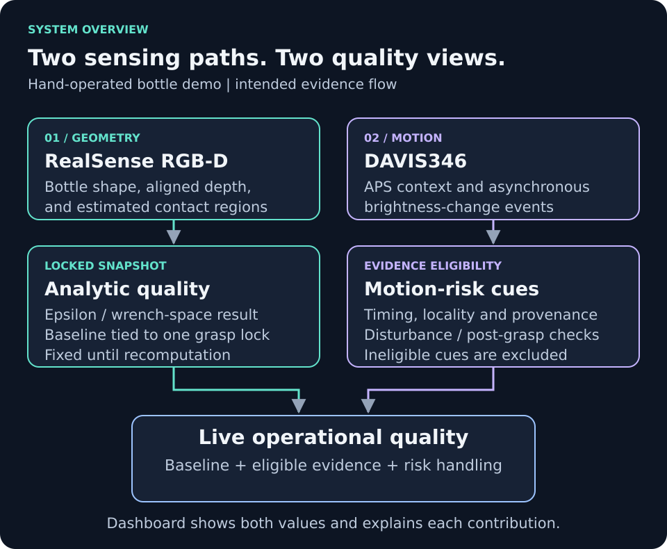

# Research method

Commands and runtime paths use `app/` as the working directory unless stated otherwise.

[Project overview](../README.md) · [Documentation index](index.md)

This page defines the method and evaluation questions. It does not establish
experimental results or literature priority.

## Research question

**How can time-aligned RGB-D and neuromorphic motion evidence improve the
interpretability of a grasp-quality estimate during handling?**

RGB-D supplies the spatial model used to evaluate a planned grasp. DAVIS
supplies event-based motion cues during manual handling. The project keeps
the locked analytic estimate separate from a live operational estimate so
that changes can be attributed to particular evidence.

## Sensor roles

| Input | Used for | Interpretation boundary |
|---|---|---|
| RealSense RGB-D | Bottle geometry, aligned depth, grasp band, and estimated contacts | Contact/geometry estimates do not establish measured force or grasp success. |
| DAVIS APS frames | Scene context and object-localization support | An image/region association is not calibrated cross-camera correspondence. |
| DAVIS events | Motion cues for incipient slip, gross slip, rotation, vibration, and disturbance | Brightness-change activity alone is not proof of physical slip. |
| Optional RGB-D point cloud | Asynchronous geometry and contact-consistency diagnostics | Its update rate and validity are separate from the main image stream. |

*Conceptual method diagram. [Full size](assets/system-overview.svg).*

## Synchronization as part of evidence eligibility

The project uses **software timestamps**, with separate checks for evidence
age and cross-sensor offset. An operator action such as manual post-grasp
declaration can anchor subsequent event windows.

This distinguishes three different ideas:

- **Display alignment:** show the latest sensor outputs side by side.
- **Temporal eligibility:** decide whether particular observations are recent
  and close enough in time to be used together.
- **Spatial calibration:** establish geometric correspondence between camera
  views. Temporal eligibility does not establish this correspondence.

*Illustrative acquisition pattern, not recorded events or a latency measurement.
[Full size](assets/software-synchronization.svg).*

The current synchronizer defines 0–300 ms impact, 300–700 ms settle, and
700–1200 ms stability windows after its action anchor. These are software
analysis intervals, not measured reaction times or hardware-triggered periods.
See [software synchronization](sensor_sync.md) for the source, default gates,
adaptive event-freshness handling, and mode distinctions.

## Movement classification and incipient-slip cues

The DAVIS analysis distinguishes object-local motion evidence from global
disturbance. Eligibility depends on timing, region/provenance, event support,
confidence, disturbance handling, and the declared phase of the trial.

The research interest in **incipient slip** is whether small motion cues can
indicate developing instability before a larger observed slip. The repository
contains estimators and configurable thresholds for this purpose. It does not
yet establish a physically measured onset threshold, warning lead time, or
superiority over frame-only monitoring.

Rotation, vibration, gross slip, lighting changes, and camera motion need
separate labelled trials. An excluded cue means it cannot support that quality
adjustment; it does not confirm that the physical grasp is stable.

## Analytic quality and live quality

The analytic epsilon/wrench-space result is associated with a locked
RealSense snapshot. A normalized analytic score is the baseline for a separate
operational estimate. Eligible evidence contributes weighted risk penalties;
smoothing and immediate hard gates affect the live estimate, not the fixed
analytic epsilon.

*Intended update structure. [Full size](assets/quality-update.svg). See
[quality matrix explained](quality_matrix_explained.md) and
[live-quality methodology](live_quality_methodology.md) for details.*

## Questions to evaluate experimentally

| Question | Comparison or trial needed | Evidence to report |
|---|---|---|
| Does temporal gating prevent misleading combinations? | Synchronized versus deliberately delayed/stale inputs from matched trials | Eligibility decisions, source timestamps, rejected stale evidence, and downstream decisions |
| Do event cues provide earlier useful warning? | RGB-D-only versus RGB-D plus DAVIS, using labelled slip onset | Detection delay relative to ground truth, missed events, and false alarms |
| Can motion classes be distinguished reliably? | Controlled slip, rotation, vibration, and stable trials | Class definitions, per-class confusion matrix, precision/recall, and trial counts |
| Are disturbances rejected? | Lighting changes, camera shake, and background motion without object slip | False-positive rate and exclusion reasons |
| Does the live estimate track observed risk? | Matched baseline-only and live-quality trials with independent outcomes | Score trajectories, lock identity, outcomes, and uncertainty |

These are evaluation requirements, not completed results. Evidence of
novelty requires both a literature comparison and an experimentally supported
contribution; implementation alone does not establish either.

## Reproducibility and evidence

For future controlled comparisons, retain the source revision, resolved
environment, configuration, device identity, mounting/calibration state,
session/lock/compute identity, acquisition timestamps, eligible/excluded
contributions, and independent trial labels. Preserve actual exported data
and the analysis procedure used to produce each figure or table.

The validation layers remain distinct:

1. **Software regression:** imports, numerical checks, and behavioral tests.
2. **Runtime checks:** device/stream availability, freshness, and ownership.
3. **Controlled physical trials:** observed handling, motion, and outcomes.

Current Benchmark Lab comparisons use masked feature views and poison tests
for feature isolation. Without appropriate ground truth, their results remain
**Estimated Performance**. Contact/force-closure metrics are not applicable to
a bottle-only comparison that provides no contact/gripper evidence. See the
[benchmark guide](benchmark_user_guide.md).

## Scope and current limits

The current presentation is a hand-operated bottle workflow. Point-cloud and
multi-view tools, alternative embodiments, and object profiles remain scoped
engineering/research capabilities; their presence does not establish physical
validation or autonomous actuation.

The diagrams describe intended contracts. Existing freshness and display-validity
limitations can allow old inputs to yield current-looking guidance. Inspect source
timestamps and retained trial evidence rather than treating a displayed readiness
label as a hardware safety or physical-validity guarantee.
