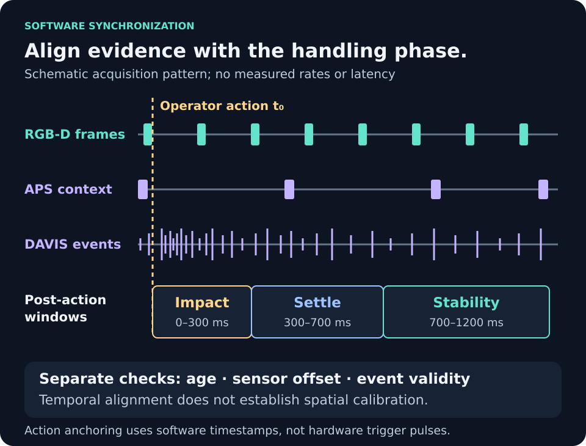

# Software sensor synchronization

Commands and runtime paths use `app/` as the working directory unless stated otherwise.

[Project overview](../README.md) · [Research method](research_methodology.md) · [Documentation index](index.md)



*Illustrative acquisition pattern, not measured data. [Full size](assets/software-synchronization.svg).*

> These are software timing checks, not measured physical synchronization or
> hardware safety limits. Existing downstream freshness and display-validity
> limitations require inspection of source timestamps and trial evidence. A
> correct gate in this module does not prove that every consumer enforces it.

The current project uses software timestamp synchronization only. It does not
require hardware trigger wires, microcontrollers, external pulses, or shared
camera clocking for the final demo.

Canonical implementation: [`sensor_sync.py`](../app/src/grasp_project/sync/sensor_sync.py).

Normal outputs:

```text
output/latest_sensor_bundle.json
output/sync_status.json
output/sensor_sync_report.json
```

## Sync Modes

`display_latest`

- Shows the latest RealSense, point cloud, DAVIS APS, and DAVIS event outputs
  side by side.
- Makes no strict fusion claim.
- Not valid for Benchmark Lab ranking or live-quality penalties.

`software_timestamp`

- Creates a bundle from available timestamps.
- Checks sensor ages and maximum timestamp offset.
- Used by Benchmark Lab and live quality when gates pass.

`action_anchored_window`

- Anchors DAVIS event analysis to an action timestamp such as
  `close_command_time` or `post_grasp_start_time`.
- Uses post-action event windows for impact, settling, and stability.
- Does not require a hardware trigger timestamp.

## Freshness Gates

Defaults declared in the synchronizer (environment overrides may change them):

| Field | Default |
|---|---:|
| `REALSENSE_MAX_AGE_MS` | 750 ms |
| `DAVIS_EVENT_MAX_AGE_MS` | 100 ms base; effective age gate also uses the selected event window |
| `DAVIS_APS_MAX_AGE_MS` | 250 ms |
| `POINTCLOUD_MAX_AGE_SEC` | 2.0 s |
| `BENCHMARK_MAX_SYNC_OFFSET_MS` | 200 ms |
| `LIVE_QUALITY_MAX_SYNC_OFFSET_MS` | 150 ms |

The event freshness gate is adaptive: `_davis_event_contribution()` uses the
larger of the selected analyzer window and `DAVIS_EVENT_MAX_AGE_MS`. Analyzer
freshness/lag can tighten the result; a cached `CURRENT` declaration must not
make an expired timestamp current again. Do not report the 100 ms base setting
as an unconditional event-age limit or measured processing latency.

The separate APS/event association settings in `config/davis.yaml` have a
different scope from these synchronizer constants; they are not interchangeable.

Freshness states:

- `CURRENT`: within the configured freshness gate.
- `AGING`: outside the gate but not yet fully stale.
- `STALE`: too old to trust as current evidence.
- `UNAVAILABLE`: missing sensor or missing timestamp.

Every bundle reports per-sensor timestamp, age, freshness, validity, and
confidence under `sensor_freshness`.

## DAVIS Event Windows

Motion-analysis windows are configurable. `config/davis.yaml` declares
5 ms micro, 25 ms short, 100 ms motion, 300 ms stability, and 1200 ms post-grasp
settings. The runtime report's selected event window is authoritative for the
adaptive freshness calculation; configuration names alone do not establish the
actual window used in a captured trial.

Post-grasp action windows:

- Impact: 0-300 ms after the action timestamp.
- Settle: 300-700 ms after the action timestamp.
- Stability: 700-1200 ms after the action timestamp.

These windows are software timestamp windows around action events. They are not
hardware-triggered windows.

## Live Quality Rules

Live-quality eligibility evaluates the DAVIS-to-RGB-D and point-cloud-to-RGB-D
offsets separately. A slow optional point cloud should not by itself disqualify
an otherwise eligible DAVIS/RGB-D pair. The combined benchmark bundle retains
its separate all-sensor diagnostics and evaluator-specific validity checks.
Temporal eligibility does not provide a calibrated transform between views.

Live quality may use DAVIS events only when:

- DAVIS events are current.
- The event window is valid.
- The software sync offset is acceptable.
- Motion confidence is acceptable.

If DAVIS events are stale, live quality does not apply DAVIS slip, rotation, or
vibration penalties. It reduces multimodal confidence and reports:

```text
DAVIS not used because event data is stale
```

Point cloud evidence is used only when the point cloud is current and geometry
is valid. Point cloud generation is slower than RealSense overlay processing and
must not be treated as a 30 FPS stream.

## Benchmark Rules

Benchmark Lab records:

- sync mode
- sensor ages
- maximum offset
- stale modalities
- unavailable modalities
- whether the bundle was valid for benchmarking
- features actually used by the masked evaluator

If an enabled modality is stale, that configuration is marked as
`VALID_WITH_LIMITATIONS` or `STALE_DATA` and should not be treated as a clean
winner.

## Future Hardware Sync

Hardware synchronization may still be useful future work for tighter scientific
timing. It is not a current setup requirement and should not block operating the
demo.
